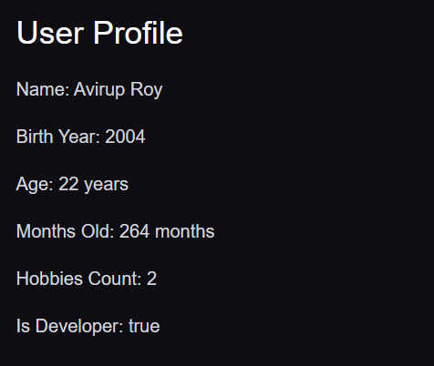
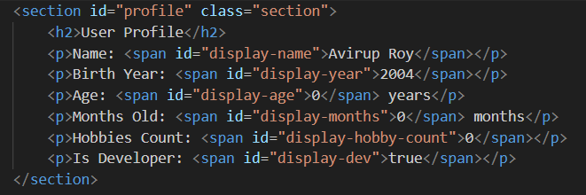
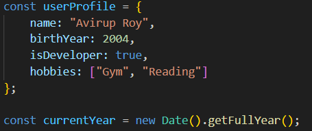
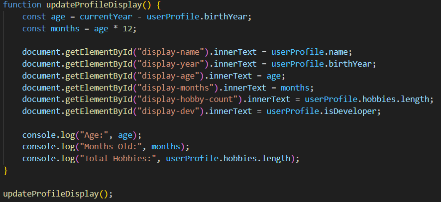
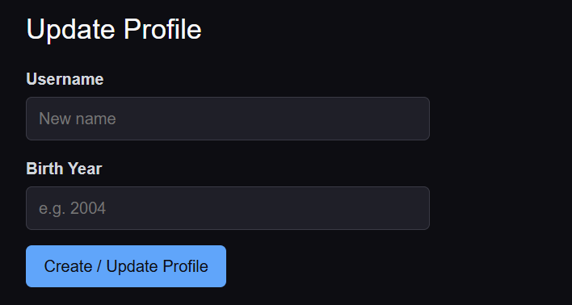
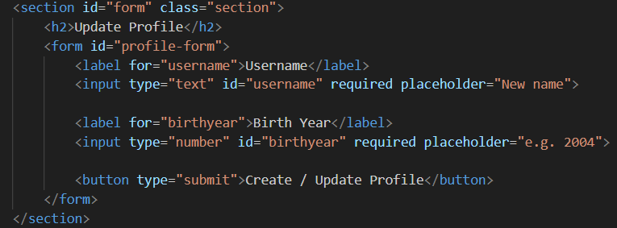
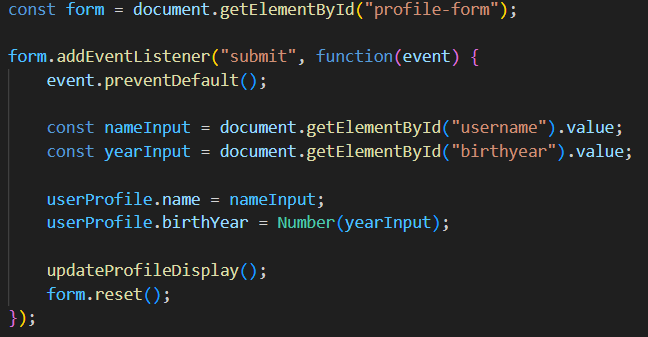
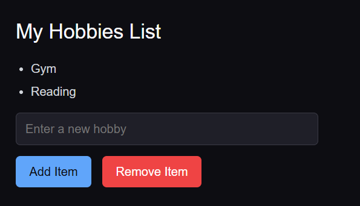
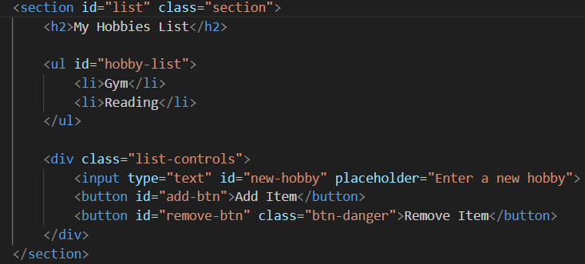
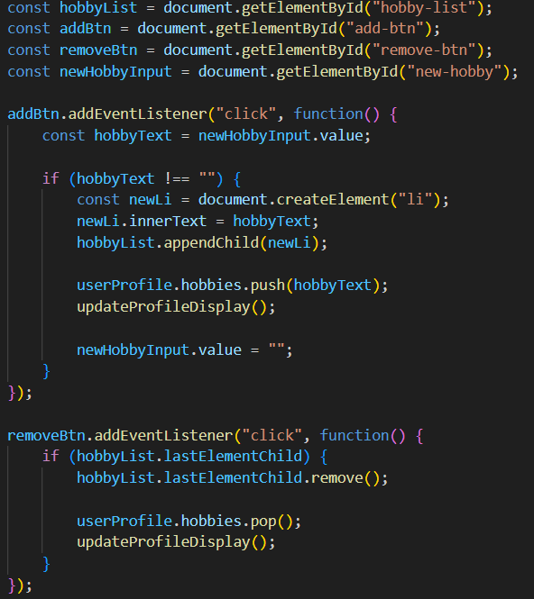

# Assignment #5: JavaScript Basics (DOM Manipulation & Events)

**Name:** Avirup Roy

**Group:** IT-2513

**Course:** Web Technologies 1

**Live Site:** https://aviruproyneal.github.io/assignment5_webtech/

---

## Part 1: Profile Object & Arithmetic

### Task 1: The Personal Info Object

I created a JavaScript `const` object named `userProfile`. It stores four different data types:
- `name` (string)
- `birthYear` (number)
- `isDeveloper` (boolean)
- `hobbies` (array)

**Screenshot:**

### Task 2: Arithmetic Calculations

I wrote a script that uses JavaScript arithmetic operators to calculate the user's age (`currentYear - birthYear`) and how many months old they are (`age * 12`). It also displays the total count of hobbies. The values are displayed both on the webpage using `innerText` and in the browser console using `console.log()`.

**Screenshot:**

---

## Part 2: Form Input & Event Responses

### Task 3: HTML Form Setup

I created a simple form with an input for the Username, an input for the Birth Year, and a "Create / Update Profile" submit button.

**Screenshot:**

### Task 4: Event Listener

I added a `submit` event listener to the form. When the user clicks the button, the script captures the input values, updates the `userProfile` object, and refreshes the displayed data. It also uses `event.preventDefault()` to stop the page from reloading.

**Screenshot:**

---

## Part 3: DOM List Manipulation

### Task 5: Creating & Removing Elements

I created an unordered list (`<ul>`) for hobbies. 
- The **Add Item** button uses `document.createElement("li")` and `appendChild()` to add a new list item to the bottom of the list.
- The **Remove Item** button uses `lastElementChild.remove()` to delete the last item in the list.

Both buttons also update the `userProfile.hobbies` array and the hobby count on the page so everything stays in sync.

**Screenshot:**

---

## Summary

This was my first time using JavaScript to interact with the DOM. The main things I learned were:

1. **Selecting elements:** Using `document.getElementById()` to grab HTML elements and `innerText` to change what's inside them.
2. **Event listeners:** Using `addEventListener()` to listen for clicks and form submissions. I learned that `event.preventDefault()` is crucial in forms to stop the page from refreshing.
3. **Creating and removing elements:** Using `document.createElement()` to build new HTML tags on the fly, and `.appendChild()` / `.remove()` to put them into the page or take them out.

---
